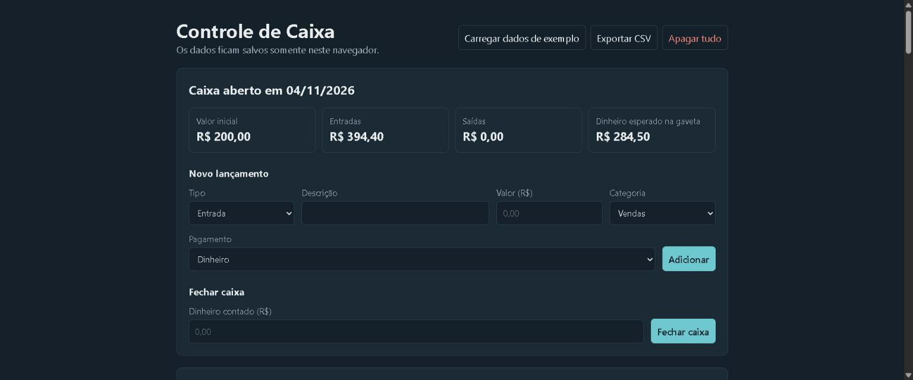
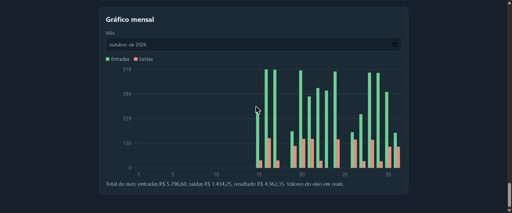

# Controle de Caixa

Sistema web para abrir, movimentar e fechar o caixa do dia.

**[Abrir o projeto](https://beasil07.github.io/controle-caixa/)**. Para ver tudo preenchido, clique em "Carregar dados de exemplo".

## Problema

Em comércios e escolas pequenas, o caixa costuma ser controlado em papel ou em planilhas soltas. Isso dificulta encontrar lançamentos e descobrir por que o dinheiro contado no fim do dia não bate com o esperado.

## Funcionalidades

- Abertura do caixa do dia com valor inicial.
- Entradas e saídas com descrição, valor, categoria e forma de pagamento.
- Edição e exclusão de lançamentos enquanto o caixa estiver aberto.
- Fechamento com comparação entre o dinheiro esperado e o contado.
- Histórico com filtro por data.
- Gráfico mensal de entradas e saídas.
- Exportação em CSV, pronta para abrir no Excel.
- Dados de exemplo e salvamento automático no navegador.

## Decisões do projeto

- **Valores em centavos:** o sistema guarda números inteiros para evitar erros de arredondamento.
- **Dinheiro esperado na gaveta:** o cálculo considera apenas pagamentos em dinheiro, porque Pix e cartão não passam pela gaveta.
- **Caixa fechado não muda:** depois do fechamento, os lançamentos ficam bloqueados.
- **Gráfico sem biblioteca:** as barras são desenhadas em SVG com JavaScript.

## Tecnologias

HTML, CSS, JavaScript, SVG e localStorage. O projeto não usa bibliotecas.

## Como rodar

Baixe o repositório e abra o arquivo `index.html` no navegador. Não é preciso instalar nada.

Os dados ficam somente no navegador de quem usa e todos os exemplos são fictícios.

## Gráfico mensal

